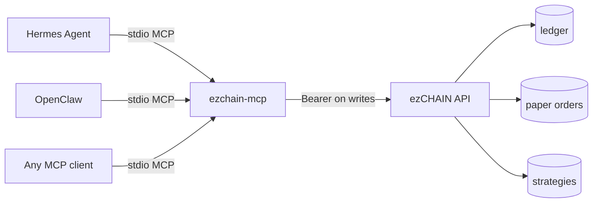

# AGENT INTEGRATION — Hermes, OpenClaw and MCP

ezCHAIN exposes one agent surface: the **MCP 2025-11-25** server in `apps/mcp`, plus the
normal REST/OpenAPI edge. Both read the same paper state; neither can create a live order.



## 1. Start the server

```bash
pip install -e apps/mcp
export EZCHAIN_API_URL=http://127.0.0.1:8000
export EZCHAIN_API_TOKEN="$(openssl rand -hex 32)"   # same value as the API
export EZCHAIN_MCP_ALLOW_WRITES=1                   # omit for read-only
ezchain-mcp
```

- Transport: stdio. stdout is protocol-only; logs go to stderr.
- Read-only is the default. Without `EZCHAIN_MCP_ALLOW_WRITES=1`, every mutation tool is
  absent from `tools/list` and cannot be called.
- The token is only needed for writes. Reads are open on the API, matching the web edge.
- There is **no** `mode` argument on any tool. The API derives `paper` server-side and
  refuses `EZCHAIN_EXECUTION_MODE=live` until the executor exists.

## 2. Hermes Agent

Hermes reads `mcp_servers` from `~/.hermes/config.yaml`:

```yaml
mcp_servers:
  ezchain:
    command: ezchain-mcp
    args: []
    env:
      EZCHAIN_API_URL: http://127.0.0.1:8000
      EZCHAIN_API_TOKEN: ${EZCHAIN_API_TOKEN}
      EZCHAIN_MCP_ALLOW_WRITES: "1"
```

Then:

```bash
hermes mcp            # verify ezchain is listed and its tools are discovered
hermes chat
```

Useful prompts:

- "Read `ezchain://state` and summarize paper equity, open positions and the kill switch."
- "List plugins, then create a paper strategy from `com.example.momentum` on SOL with a
  60-minute interval and 1% risk. Validate the config first."
- "Run `ezchain_get_live_readiness` for this strategy and explain every failed check.
  Do not promote it."
- "Backtest the graph with 30 bps fees and 20 bps slippage over 500 bars; report the
  data source and fill model."

Hermes supports per-server tool filtering; allowlist the read tools for an analyst
profile and add write tools only for an operator profile.

## 3. OpenClaw

```bash
openclaw mcp add ezchain \
  --command ezchain-mcp \
  --env EZCHAIN_API_URL=http://127.0.0.1:8000 \
  --env EZCHAIN_API_TOKEN="$EZCHAIN_API_TOKEN" \
  --env EZCHAIN_MCP_ALLOW_WRITES=1
openclaw mcp doctor ezchain --probe
```

Or in config:

```json5
{
  mcp: {
    servers: {
      ezchain: {
        command: "ezchain-mcp",
        transport: "stdio",
        enabled: true,
        env: {
          EZCHAIN_API_URL: "http://127.0.0.1:8000",
          EZCHAIN_API_TOKEN: "${EZCHAIN_API_TOKEN}",
          EZCHAIN_MCP_ALLOW_WRITES: "1"
        },
        toolFilter: { include: ["ezchain_*"] }
      }
    }
  }
}
```

OpenClaw applies its normal tool profile and approval policy to every MCP tool. Keep
`ezchain_arm_kill_switch` and `ezchain_place_paper_order` behind an approval prompt; they
are marked `destructiveHint`/write in the tool annotations.

## 4. Tool surface

Read tools (always available):

| Tool | Data |
|---|---|
| `ezchain_get_mode` | execution/data mode, live availability, auth rules |
| `ezchain_get_agent_state` | mode, kill switch, risk, account, positions, strategies, plugins |
| `ezchain_list_markets` | multi-chain market rows |
| `ezchain_get_token` | price, liquidity, volume, changes, safety |
| `ezchain_get_candles` | closed OHLCV bars |
| `ezchain_get_account` | paper cash/equity/PnL |
| `ezchain_list_positions` | open positions |
| `ezchain_list_orders` / `ezchain_list_fills` | execution history |
| `ezchain_get_performance` | account performance and equity curve |
| `ezchain_get_ledger` | append-only journal |
| `ezchain_get_reconciliation` | ledger/fill/position agreement |
| `ezchain_list_strategies` / `ezchain_get_strategy` | strategy catalogue |
| `ezchain_get_strategy_runs` | decision log |
| `ezchain_get_strategy_performance` | per-strategy PAPER performance |
| `ezchain_get_live_readiness` | paper-gate evidence |
| `ezchain_list_plugins` | manifests, permissions, discovery issues |
| `ezchain_list_backtests` / `ezchain_get_backtest` | immutable backtests |
| `ezchain_get_system_status` | health, readiness, kill switch |
| `ezchain_get_graph_catalogue` / `ezchain_validate_graph` / `ezchain_dry_run_graph` | visual graph tooling |

Write tools (only with `EZCHAIN_MCP_ALLOW_WRITES=1`):

`ezchain_create_strategy`, `ezchain_update_strategy`, `ezchain_pause_strategy`,
`ezchain_resume_strategy`, `ezchain_delete_strategy`, `ezchain_run_strategy`,
`ezchain_place_paper_order`, `ezchain_run_backtest`, `ezchain_arm_kill_switch`,
`ezchain_disarm_kill_switch`, `ezchain_reload_plugins`,
`ezchain_validate_plugin_config`.

Every write still requires `Authorization: Bearer <EZCHAIN_API_TOKEN>` at the API. The
MCP server is not an auth bypass.

## 5. Resources

`resources/list` returns static resources plus concrete URIs for current strategies and
backtests:

- `ezchain://state`, `ezchain://capabilities`, `ezchain://markets`
- `ezchain://positions`, `ezchain://account`, `ezchain://ledger`
- `ezchain://strategies`, `ezchain://plugins`, `ezchain://system`
- `ezchain://reconciliation`
- `ezchain://strategies/{id}`, `/runs`, `/performance`, `/live-readiness`
- `ezchain://backtests/{id}`

`resources/templates/list` publishes the templates. Reads return JSON text and never
mutate.

## 6. REST for agents without MCP

The same data is on the OpenAPI edge. Start with:

```bash
curl http://127.0.0.1:8000/api/v1/agent/state
curl http://127.0.0.1:8000/api/v1/agent/capabilities
curl http://127.0.0.1:8000/api/v1/plugins
```

Mutations need the bearer token. The web proxy injects it server-side; a standalone
agent must hold it in its own secret store, never in a prompt or a model context.

## 7. Safety model

- **Paper only.** No signing, no wallet, no live venue call exists in this path.
- **Server-derived mode.** A tool call cannot request `live`; the mode is a boot setting
  and `live` is refused until the executor ships.
- **Kill switch.** Strategy-originated execution is blocked when armed; manual paper
  orders remain available for inspection.
- **Risk clamps.** A plugin's notional is clamped by the existing paper risk policy; a
  rejected order is logged with its reason.
- **Read-only default.** An agent that only needs to observe never sees a write tool.
- **Tool poisoning is real.** MCP tool descriptions, resource text and plugin metadata
  are untrusted data. Keep MCP servers allowlisted, review plugin manifests before
  install, and do not let an agent follow instructions embedded in market text. See
  OWASP MCP03 (tool poisoning) and Microsoft's MCP control-plane guidance in
  [`RESEARCH-2026.md`](RESEARCH-2026.md).
- **No autonomous promotion.** `ezchain_get_live_readiness` reports evidence; it cannot
  promote. Live promotion is an owner action, gated by the paper gate and the executor.
