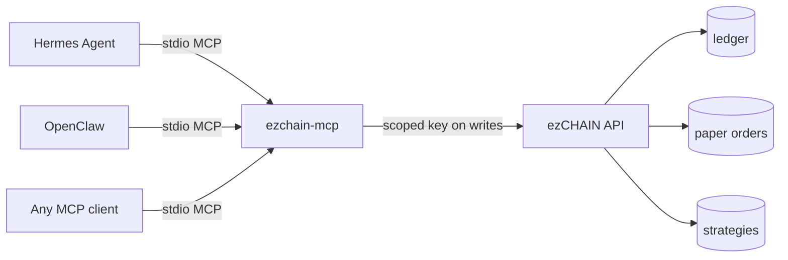

# AGENT INTEGRATION — Hermes, OpenClaw and MCP

ezCHAIN exposes one agent surface: the **MCP 2025-11-25** server in `apps/mcp`, plus the
normal REST/OpenAPI edge. Both read the same paper state; neither can create a live order.
The same seam is designed to back ezCHAIN's own agent runtime — decided, not built — and an
external agent brought over the Agent Client Protocol, also a planned path: each would run as
a separate process whose only egress is that MCP server, holding a scoped key (§9).



> **ALPHA / PAPER ONLY.** These packs are local integrations, not official marketplace
> listings. Official Hermes/OpenClaw publication is gated on real-mode readiness and
> upstream review (see `ROADMAP.md`). Do not use this deployment for real money.

## 0. One-command packs

| Harness | Pack | Install |
|---|---|---|
| Hermes | `integrations/hermes` | `bash integrations/hermes/install.sh` then `hermes mcp add` |
| OpenClaw | `integrations/openclaw` | `openclaw plugins install ./integrations/openclaw --accept-capabilities` |

The OpenClaw pack is an Agent Plugins 1.0.0 bundle (`plugin.json` + `mcp.json` +
`skills/ezchain-trading`). OpenClaw detects it as `format: bundle`, `bundleFormat: agent`
with `skills` and `mcpServers` capabilities. The Hermes pack installs an agentskills.io
skill and prints the MCP registration command. Both read the same `apps/mcp` server.

## 1. Start the server

```bash
pip install -e apps/mcp
export EZCHAIN_API_URL=http://127.0.0.1:8000

# Mint a scoped key with the deployment token (shown once), then hand only that to the agent.
curl -sS -X POST "$EZCHAIN_API_URL/api/v1/agent/keys" \
  -H "Authorization: Bearer $EZCHAIN_API_TOKEN" \
  -H 'content-type: application/json' \
  -d '{"subject":"hermes","scopes":["read","trade"]}'

export EZCHAIN_API_TOKEN="ezk_…"   # the scoped key from §4, never the deployment token
export EZCHAIN_MCP_ALLOW_WRITES=1   # omit for read-only
ezchain-mcp
```

- Transport: stdio. stdout is protocol-only; logs go to stderr.
- Read-only is the default. Without `EZCHAIN_MCP_ALLOW_WRITES=1`, every mutation tool is
  absent from `tools/list` and cannot be called.
- Writes open only for a **scoped** key. At startup the server reads the admin-only
  `GET /api/v1/agent/keys` route: a credential that answers there (the deployment token or
  any `admin` key) keeps the server read-only, prints the mint command above, and repeats
  it in the `initialize` instructions. A revoked key or an unreachable API also fails
  closed. There is no flag that overrides this.
- The token is a **scoped agent key**, not the deployment admin token. `read` and `trade`
  are the scopes an agent uses; an `admin` key is refused for writes exactly like the
  deployment token. Reads are open on a self-hosted workspace; set
  `EZCHAIN_REQUIRE_AUTH_FOR_READS=true` on a hosted deployment and the token is required
  for both reads and writes.
- Kill-switch control and plugin reload are admin operations with no MCP tool. An agent's
  halt is `ezchain_pause_strategy`; a person operates the switch over REST.
- There is **no** `mode` argument on any tool. The API derives `paper` server-side and
  refuses `EZCHAIN_EXECUTION_MODE=live` until the executor exists.

## 2. Hermes Agent

Hermes reads `mcp_servers` from `~/.hermes/config.yaml`:

```yaml
mcp_servers:
  ezchain:
    command: ezchain-mcp
    args: []
    env:
      EZCHAIN_API_URL: http://127.0.0.1:8000
      EZCHAIN_API_TOKEN: ${EZCHAIN_API_TOKEN}
      EZCHAIN_MCP_ALLOW_WRITES: "1"
```

Then:

```bash
hermes mcp            # verify ezchain is listed and its tools are discovered
hermes chat
```

Useful prompts:

- "Read `ezchain://state` and summarize paper equity, open positions and the kill switch."
- "List plugins, then create a paper strategy from `com.example.momentum` on SOL with a
  60-minute interval and 1% risk. Validate the config first."
- "Run `ezchain_get_live_readiness` for this strategy and explain every failed check.
  Do not promote it."
- "Backtest the graph with 30 bps fees and 20 bps slippage over 500 bars; report the
  data source and fill model."

Hermes supports per-server tool filtering; allowlist the read tools for an analyst
profile and add write tools only for an operator profile.

## 3. OpenClaw

First-class bundle:

```bash
pip install -e apps/mcp
openclaw plugins install ./integrations/openclaw --accept-capabilities
openclaw plugins inspect ezchain --json
```

Observed on OpenClaw 2026.10.6: `format: bundle`, `bundleFormat: agent`,
`bundleCapabilities: ["skills","mcpServers"]`, skill `ezchain-trading` ready, and one
stdio MCP server named `ezchain`. The bundle wrapper reads
`~/.config/ezchain/agent.env` (0600), so credentials never enter the plugin manifest or
`openclaw.json`.

The equivalent hand-wired MCP definition (also valid):

```json5
{
  mcp: {
    servers: {
      ezchain: {
        command: "ezchain-mcp",
        transport: "stdio",
        enabled: true,
        env: {
          EZCHAIN_API_URL: "http://127.0.0.1:8000",
          EZCHAIN_API_TOKEN: "${EZCHAIN_API_TOKEN}",
          EZCHAIN_MCP_ALLOW_WRITES: "1"
        },
        toolFilter: { include: ["ezchain_*"] }
      }
    }
  }
}
```

OpenClaw applies its normal tool profile and approval policy to every MCP tool. Keep
`ezchain_delete_strategy` and `ezchain_place_paper_order` behind an approval prompt; they
are marked destructive/write in the tool annotations. The server refuses to expose any
write tool unless `EZCHAIN_API_TOKEN` is a scoped read/trade key.

The API gates agent orders too. Under the default `manual` automation tier an order from
an agent key is not filled: `ezchain_place_paper_order` returns the stored order with
`status: "pending_approval"`, `approval_id`, `approval_status: "pending"` and
`next_action: "wait_for_a_person"`, and a person approves or rejects it at
`POST /api/v1/paper/approvals/{id}/approve|reject`. A harness's own approval prompt is
therefore not the last gate; it is the first of two. `ezchain_list_approvals` reads the
queue and `ezchain_get_automation` reports the tier. An agent cannot approve its own order
(that is `403 APPROVAL_REQUIRES_PERSON`) or turn the tier up; only a person can. A user who
has opted into `full_auto` with the recorded risk acknowledgement gets the old behaviour:
the order fills and the two approval fields are null.

## 4. Scoped agent keys

Mint one key per agent or user with the deployment admin token:

```bash
curl -sS -X POST http://127.0.0.1:8000/api/v1/agent/keys \
  -H "Authorization: Bearer $EZCHAIN_API_TOKEN" \
  -H 'content-type: application/json' \
  -d '{"subject":"hermes-alice","scopes":["read","trade"],"label":"Alice desk"}'
```

The response contains the plaintext token **once**. Only a peppered SHA-256 hash is
stored. `GET /api/v1/agent/keys` (admin) lists metadata; `DELETE /api/v1/agent/keys/{id}`
revokes.

| Scope | Grants |
|---|---|
| `read` | GET/HEAD endpoints when `EZCHAIN_REQUIRE_AUTH_FOR_READS=true` |
| `trade` | paper orders, strategies, runs, backtests |
| `admin` | key management, plugin reload, kill-switch mutations |

Set `EZCHAIN_API_KEY_PEPPER` (>= 32 random bytes) before minting keys in production.
Rotating it invalidates every key. A `trade` key that calls an admin route gets
`403 FORBIDDEN`; an absent/revoked/expired key gets `401 UNAUTHORIZED`.

An agent gets a scoped key or it gets read-only. The MCP server never enables writes for
the deployment token or any `admin` key — those can release the kill switch and reload
plugins, so the server probes `GET /api/v1/agent/keys` at startup and refuses when the
credential can read it (§1).

One ezCHAIN instance is one paper workspace. A key names the actor inside that workspace;
it does not partition the ledger. For a hosted multi-user product, run one workspace (or
one reverse-proxied route) per user and mint one key per agent.

## 5. Tool surface

Read tools (always available):

| Tool | Data |
|---|---|
| `ezchain_get_mode` | execution/data mode, live availability, auth rules |
| `ezchain_get_agent_state` | mode, kill switch, risk, account, positions, strategies, plugins |
| `ezchain_list_markets` | multi-chain market rows |
| `ezchain_get_token` | price, liquidity, volume, changes, safety |
| `ezchain_get_candles` | closed OHLCV bars |
| `ezchain_get_account` | paper cash/equity/PnL |
| `ezchain_list_positions` | open positions |
| `ezchain_list_orders` / `ezchain_list_fills` | execution history |
| `ezchain_get_performance` | account performance and equity curve |
| `ezchain_get_ledger` | append-only journal |
| `ezchain_get_reconciliation` | ledger/fill/position agreement |
| `ezchain_list_strategies` / `ezchain_get_strategy` | strategy catalogue |
| `ezchain_get_strategy_runs` | decision log |
| `ezchain_get_strategy_performance` | per-strategy PAPER performance |
| `ezchain_get_live_readiness` | paper-gate evidence |
| `ezchain_list_plugins` | manifests, permissions, discovery issues |
| `ezchain_list_backtests` / `ezchain_get_backtest` | immutable backtests |
| `ezchain_get_system_status` | health, readiness, kill switch |
| `ezchain_get_graph_catalogue` / `ezchain_validate_graph` / `ezchain_dry_run_graph` | visual graph tooling |

Write tools (only with `EZCHAIN_MCP_ALLOW_WRITES=1`, and only for a scoped key):

`ezchain_create_strategy`, `ezchain_update_strategy`, `ezchain_pause_strategy`,
`ezchain_resume_strategy`, `ezchain_delete_strategy`, `ezchain_run_strategy`,
`ezchain_place_paper_order`, `ezchain_run_backtest`, `ezchain_validate_plugin_config`.

Every write still requires `Authorization: Bearer <scoped agent key>` at the API. The
MCP server is not an auth bypass.

Three admin routes are deliberately absent from the surface: `POST /api/v1/system/kill-switch`
(arm and release) and `POST /api/v1/plugins/reload`. They need the `admin` scope, which an
agent key must not carry and which the MCP server refuses for writes, so an MCP tool would
only ever return `403 FORBIDDEN`. The operator performs them over REST.

## 6. Resources

`resources/list` returns static resources plus concrete URIs for current strategies and
backtests:

- `ezchain://state`, `ezchain://capabilities`, `ezchain://markets`
- `ezchain://positions`, `ezchain://account`, `ezchain://ledger`
- `ezchain://strategies`, `ezchain://plugins`, `ezchain://system`
- `ezchain://reconciliation`
- `ezchain://strategies/{id}`, `/runs`, `/performance`, `/live-readiness`
- `ezchain://backtests/{id}`

`resources/templates/list` publishes the templates. Reads return JSON text and never
mutate.

## 7. REST for agents without MCP

The same data is on the OpenAPI edge. The state snapshot aggregates the whole
workspace and needs a principal with the `read` scope; the capability and plugin
catalogues are open unless `EZCHAIN_REQUIRE_AUTH_FOR_READS=true` closes reads.

```bash
curl -H "Authorization: Bearer $EZCHAIN_API_TOKEN" \
  http://127.0.0.1:8000/api/v1/agent/state
curl http://127.0.0.1:8000/api/v1/agent/capabilities
curl http://127.0.0.1:8000/api/v1/plugins
```

Mutations need the same bearer token. The web proxy injects it server-side; a standalone
agent must hold it in its own secret store, never in a prompt or a model context.

## 8. Safety model

- **Paper only.** No signing, no wallet, no live venue call exists in this path.
- **Server-derived mode.** A tool call cannot request `live`; the mode is a boot setting
  and `live` is refused until the executor ships.
- **Kill switch.** Strategy-originated execution is blocked when armed; manual paper
  orders remain available for inspection. Arming and releasing it are admin actions on
  REST, not agent tools.
- **Risk clamps.** A plugin's notional is clamped by the existing paper risk policy; a
  rejected order is logged with its reason.
- **Read-only default.** An agent that only needs to observe never sees a write tool.
- **No deployment token.** Writes open only for a scoped key. The server probes an
  admin-only route at startup and stays read-only for the deployment token, an `admin`
  key, a revoked key or an unreachable API.
- **Workspace snapshot.** `/api/v1/agent/state` always needs a `read` principal; it
  aggregates the account, positions and reconciliation in one document.
- **Scoped keys.** `read` cannot trade, `trade` cannot administer, and revocation is
  immediate. `EZCHAIN_REQUIRE_AUTH_FOR_READS=true` closes the rest of the read surface.
- **Tool poisoning is real.** MCP tool descriptions, resource text and plugin metadata
  are untrusted data. Keep MCP servers allowlisted, review plugin manifests before
  install, and do not let an agent follow instructions embedded in market text. See
  OWASP MCP03 (tool poisoning) and Microsoft's MCP control-plane guidance in
  [`RESEARCH-2026.md`](RESEARCH-2026.md).
- **No autonomous promotion.** `ezchain_get_live_readiness` reports evidence; it cannot
  promote. Live promotion is an owner action, gated by the paper gate and the executor.
- **The runtime is outside the money path.** The built-in runtime is designed to speak only
  MCP with a scoped key, hold no key material and write no platform table (§9, ADR-0042).

## 9. The built-in agent runtime

ezCHAIN's own agent is a separate service, `services/agent-runtime` (ADR-0042), decided but
not built: neither the service, the panel nor the headless command exists in the repository,
and the Agent Client Protocol path is planned with no implementation. When built it runs one
model loop with the platform's tools; the panel and the headless command are its two entry
points, and an external agent over the Agent Client Protocol would use the same boundary. The
panel is additionally blocked on the owner's design export: `design/` is the source of truth
for visuals, and no agent-panel design has been exported yet. The runtime is not part of the
API, the engine or the executor, and no strategy code runs in it — strategies stay external
SDK packages hosted by the engine.

- **One egress.** It reaches ezCHAIN only through a child `ezchain-mcp` over stdio with a
  scoped `read`/`trade` key. It has no REST client, no database connection and no shared
  process or filesystem with the platform. An unreachable MCP server fails the session
  closed; there is no direct-API fallback.
- **Two-way credential isolation.** Model-provider credentials are read from the runtime's
  own environment and never stored in the platform, the vault, the MCP server, a trace, a
  log line or the browser. Venue and market-data credentials stay in the operator's
  encrypted provider-key store or the executor, and the runtime holds none. The one
  platform credential it holds is the agent key, and it never enters a prompt or the trace.
- **The tools are the boundary.** Two gates decide what the runtime can call:
  `EZCHAIN_MCP_ALLOW_WRITES=1`, with a verified scoped key, exposes the write tools at all,
  and the API enforces the key's `read`/`trade` scope on every route. Inside those tools
  there is no shell, URL fetch, filesystem, subprocess or code execution. It may read the
  state and the approval queue, propose paper orders, and create, change, delete or run
  strategy records the platform validates. It cannot approve its own proposal, change the
  automation tier, arm or release the kill switch, reload plugins, mint keys or set a mode.
- **The platform is the trust boundary.** An order placed through the runtime is `agent`,
  addressed by the key id (ADR-0037), and waits under `manual` like any other agent order.
  The runtime never sees a wallet key, a `KeyHandle` or the vault; when the executor's live
  path exists the vault signs for the owner's handle and the runtime receives only the
  outcome. Every money number it states is read from a tool result.
- **Two audit records.** The runtime will write an append-only session trace in its own
  store — prompt hash, model, tool, arguments, result summary, latency, tokens, cost,
  approval id — redacted on write and replayable; that store is planned, not built. The
  platform keeps the money record: order and journal rows with the agent principal, the
  approval with its risk evidence and `decided_by`, and the executor's pipeline check that
  decodes the bytes against the approved digest before any signer runs (ADR-0038).
  Attribution of kill-switch changes is not implemented: the switch row holds only its
  state, reason and update time. They join on approval id, order id and key id, and neither
  substitutes for the other.

The full decision, options and consequences are in [DECISIONS.md](DECISIONS.md) (ADR-0042).
