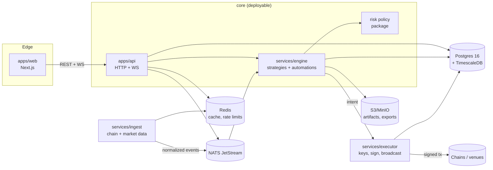
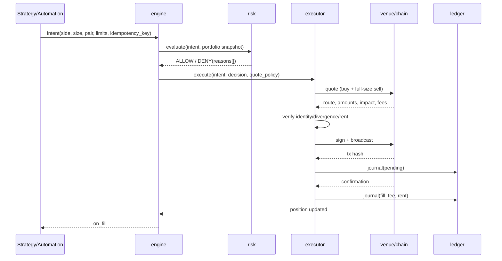

# ARCHITECTURE — ezCHAIN

Status: **PAPER stack with production operations**. The web UI (`apps/web`), FastAPI edge
(`apps/api`), strategy runtime (`services/engine`, inline), domain/ledger
(`packages/core-py`) and DexScreener / Jupiter adapters (`packages/adapters`) are built,
with Alembic migrations, bearer auth, `/healthz`/`/readyz`/`/metrics`, structured logs and a
stress harness. Market observation is a bounded inline loop in the API. Graph strategies
are live on the PAPER path (`/api/v1/graph/*`, `/api/v1/backtests`). External strategy
plugins run as `kind=plugin` in a supervised worker, and `apps/mcp` exposes the read
surface plus paper-only mutations to MCP agents. The **executor** implements the reference
`Intent → RiskDecision → Quote → Order → Fill → Journal` pipeline
(`services/executor/src/ezchain_executor/pipeline.py`) against a venue behind the core
`Venue` protocol. It is not yet the paper executor: the paper order service
(`apps/api/src/ezchain_api/services/paper.py`) still validates risk, writes the order/fill
and appends ledger rows directly, and remains the caller of record for paper orders; its
delegation to the executor pipeline is tracked separately. Key custody, signing and live
broadcast are still not built, and live execution is disabled on every chain.
Timescale conversion and retention for market observations exist now; a NATS relay and
continuous aggregates do not. This document is the contract every later PR
implements; deviations require an ADR.

## 1. Shape

**Modular monolith + two hard boundaries.** The core (API, engine, ingest workers) is one
deployable modular application with enforced package boundaries. The **executor** is a
separate process because it is the only key holder. The **ingest** workers can scale
separately because they are I/O-bound and chain-specific.



Why not microservices: v2 and v3 both described 9 services and shipped one process, so the
boundary was fiction; pumpbot's monolith made iteration fast but concurrency unsafe. A
modular monolith with real import boundaries and one separately-scaled executor gets the
iteration speed without lying about the topology.

## 2. Deployables

| Deployable | Language | Responsibility | Scaling |
|---|---|---|---|
| `apps/web` | TypeScript / Next.js | UI, routing, formatting, WS client | stateless, N |
| `apps/api` | Python 3.12 / FastAPI | auth, REST, WS gateway, read models, command API | stateless, N |
| `services/engine` | Python | strategy runtime, automation scheduler, signal routing, risk | 1 per workspace partition |
| `services/executor` | Python | key custody, signing, broadcast, fill confirmation | 1 per key shard |
| `services/ingest` | Python (Rust only if measured) | market/chain streams, normalization, candles | per source, N |
| `services/agent-runtime` | Python | one model loop, MCP-only tool surface, budgets, session lifecycle, append-only trace and replay; stdio transport planned (ADR-0042) | 1 per session, N |
| `migrate` | Python | one-shot Alembic | run-to-completion |
| `apps/desktop` | TypeScript / Electron + Python | native shell, private sidecar supervision, tray/background | 1 per desktop user |

Single-node default = one `core` container (api+engine) + `executor` + `ingest` + data
services. The same images scale out unchanged.

### Desktop deployment

`apps/desktop` is a native Electron shell for a single user. It starts the same FastAPI
edge and the traced Next.js server as private loopback sidecars, with an embedded SQLite
database at `~/.config/ezCHAIN/ezchain.db` instead of Postgres. Both sidecars bind
`127.0.0.1` on ephemeral ports; the renderer gets no token or Node access. Closing the
window hides to the tray and the sidecars keep running; a watchdog restarts either one on
crash. AppImage and `.deb` are built from the repository; macOS/Windows targets need a
build on their own host. See [DESKTOP.md](DESKTOP.md).

## 3. Module map (monorepo)

```
apps/
  web/                     # Next.js 15, App Router, CSS tokens (ADR-0013)
  api/                     # FastAPI edge
  mcp/                     # MCP 2025-11-25 server (stdio) for agents
integrations/              # Hermes/OpenClaw packs (skill + MCP registration)
services/
  engine/                  # strategy host, automation scheduler, signal router
  agent-runtime/           # built-in agent loop: MCP tool surface, model seam, budgets, lifecycle (ADR-0042)
  harness/                 # headless command: runs one agent-runtime session, prints its trace
  executor/                # pipeline (intent -> journal), vault, signer, broadcaster, confirmer
  ingest/                  # sources/{chain,venue,cex,social}, normalizers, candles
packages/
  core_py/                 # domain: money, ledger, orders, positions, risk policy
  sdk_py/                  # standalone public strategy SDK (Apache-2.0)
  adapters/
    chain_solana/ chain_evm/ chain_move/ chain_cosmos/ chain_bitcoin/ chain_ton/ ...
    venue_jupiter/ venue_uniswap/ venue_pancake/ venue_oneinch/ venue_cex/
  ui/                      # design tokens + primitives shared by web
  contracts/               # OpenAPI + event schemas (generated, checked in)
tools/                     # gates, generators
design/                    # wireframe + brief (source of truth for visuals)
infra/                     # compose, Caddy, Prometheus, Grafana
```

Import boundaries, documented here and to be enforced by import linter contracts:

- `core_py` imports nothing from `apps/`, `services/`, `adapters/`, `sdk_py`.
- `apps/api` never imports `services/executor`; only the executor HTTP client.
- `adapters/*` import `core_py` and their chain SDK; never another adapter.
- `sdk_py` imports no platform code at all; it is a standalone Apache-2.0 package.
- `services/engine` never touches key material or signing libraries.
- `services/agent-runtime` imports no platform code; its only egress is `apps/mcp` over
  stdio with a scoped key (ADR-0042). The loop exists; the stdio transport, the import-linter
  contract and service isolation are planned, so the boundary is held by review for now.
- `services/harness` is the loop's terminal entry point: it imports `ezchain_agent_runtime`
  and nothing else from the platform, builds the real `AgentLoop`, and reports its outcome
  as an exit code. The panel is the other entry point and uses the same loop.

Module size budget: ≤ 800 LOC per module, ≤ 400 LOC per file outside generated code. A
module that needs more is two bounded contexts. (v3's 697 KB `service.py` is the counter-
example.)

## 4. Data flow

### 4.1 Market data

`ingest` connects to RPC/WS/REST per source → normalizes into the one
`ezchain_core.MarketEvent` (`chain, venue, pair, price, size, direction, units,
confidence, source, source timestamp, observed_at`) → publishes to NATS `market.*` →
engine consumes; API serves snapshots; candles are materialized into Timescale
hypertables.

Rules: every event declares units and freshness; a late event is flagged, not silently
reordered; duplicate `(source name, pair, source timestamp)` is idempotent, in the replay
and in the table's primary key.

`MarketEvent` is the only market-event type: adapters write their own wire parsing but
normalise into it, and `services/ingest` records through its one serialiser. Age and
staleness are derived from the reader's clock, never stored, so a recorded JSONL file
replays to identical derived state (contract I9). The JSONL recording stays the replay
input; `ezchain_ingest.store` writes the same normalised event to `market_events` (the
query path) and appends one `market_outbox` row in the same transaction, so a consumer is
never told about a write that rolled back. Reads return `MarketEvent` values, so the API's
market read models (`/api/v1/markets` rows, `/api/v1/markets/stored` rows and the token
header) apply the same rule through `services/market_reads.provenance`: `source` is the
row's `SourceRef`, `age_seconds` is that timestamp against the read clock, and `stale` is
the contract's verdict. A row with no usable source reports all three as unknown rather
than a zero age, and an adapter's own freshness flag never decides what the API serves.

**P0 inline observation.** `apps/api` also runs a bounded market monitor
(`EZCHAIN_MARKET_SCAN_INLINE`, default on) so the platform knows what it can see even when
no user has a token page open. One scan calls `DexScreenerClient.discover_markets(chain="all")`
once; that adapter call fans out one token lookup per registered chain (seeds first, four
in flight) because `/latest/dex/tokens` caps a response at 30 pairs, then round-robins the
ranked per-chain rows. The returned coverage tells the monitor which chains were already
attempted, so it does not re-probe them; a second bounded per-chain pass runs only when the
all-chain call raised or returned no coverage. Each observed pair is projected onto its base
token and persisted through `market_snapshots.record_snapshot` before it can appear in
`/api/v1/markets/overview` or `/api/v1/markets/stored`. A failed provider or chain records
`error` (coverage reason `error`) and the scan continues. Row counts and ages are DB-derived,
so the overview survives a restart; attempt times and error text are process-local. A chain
with no rows is `no_data`, and an old row is `stale` after
`max(60s, scan interval + last scan duration + 15s)` — never zero.

**Freshness is per source class.** `ezchain_core.freshness.FreshnessPolicy` bounds a read's
age by the kind of read (`mark`, `quote`, `candle`, `feed`), and each read is classified as
`fresh`, `stale`, `unknown` (no observation) or `future` (dated ahead of the clock). Only
`fresh` prices. A stale mark refuses to price an *entry* and never values the account
(every money number stays `null` and the account is incomplete); a reduce-only exit still
settles because it sizes from the held quantity, never the mark, and on a `paper_mark`-only
chain it settles at the last observed mark rather than being trapped. `EZCHAIN_MAX_MARK_AGE_SECONDS`,
`EZCHAIN_MAX_QUOTE_AGE_SECONDS`, `EZCHAIN_MAX_CANDLE_AGE_SECONDS` and
`EZCHAIN_MAX_FEED_AGE_SECONDS` feed one policy, which the order gate, the quote router and
the alert tracker all share. The budgets reach every snapshot producer, not just the order
path, so `TokenSnapshot.stale` is a real age and not a constant.

A source that goes stale raises one `provider_stale` alert per transition, keyed
`(chain, token, kind)`, not one per request; `GET /paper/alerts` drains the router's queue,
which is bounded so a surface nobody reads cannot grow without bound. The transition state
is in memory: a restart forgets it and re-raises once per process for a source that is
still stale. That is documented, not hidden — a durable alert sink is a different feature.
A cached provider payload keeps the time the provider answered it, so a re-read cannot
re-stamp an old price as current.

### 4.2 Candle history

Graph strategies need indicator inputs (EMA/RSI/ATR) and a backtest needs bars, so OHLCV
history is served from `market_candles` rather than recomputed per request:

- `GET /api/v1/tokens/{chain}/{address}/candles?timeframe=5m&limit=300` (read-only; no
  auth by default, `read` scope when `EZCHAIN_REQUIRE_AUTH_FOR_READS=true`)
  returns closed bars oldest first, prices and volumes as decimal strings, unknown volume as
  `null`, plus `source`, `stale`, `pool_address` and a `reason` code when empty.
- The pool is the highest-liquidity pair of the token snapshot the markets router already
  uses; the provider call passes our token address as `token`, so the price belongs to our
  token even when it is the quote side.
- **The forming bar is dropped** (`open_time + timeframe > now`) before it is stored or
  served, so an indicator never sees a bar that keeps changing under the same timestamp.
- The table is consulted first. A request reaches GeckoTerminal only when the newest stored
  bar is not the latest closed bar for `now`, or when the stored series is shorter than
  `limit` (one bounded page backwards with `before_timestamp`). Re-fetching a bar updates it
  in place: the unique key is `(chain, token_address, timeframe, open_time)`.
- Chains are capabilities, not branches: `ChainMeta.geckoterminal_id` (adapter-owned) is the
  only place a provider network id appears, and `to_dict()` exposes `capabilities.candles`.
  A registered chain with no provider (Osmosis, Cosmos Hub) returns
  `CANDLES_UNSUPPORTED_CHAIN` — never a fabricated series.
- `EZCHAIN_DATA_MODE=fixture` synthesizes a deterministic series labelled `fixture` and does
  not write to the table, so a demo cannot be mistaken for market data.

### 4.3 Graph strategy evaluation

A `kind = "graph"` strategy is typed JSON evaluated by `ezchain_core.graph.evaluate_graph`.
The API composition root supplies a `GraphContextBuilder` to the engine: it takes the live
token snapshot, closed candles from `market_candles`, the ledger-replayed position and the
paper account, and freezes them into one `EvalContext`. The scheduler maps the resulting
`GraphDecision` onto the existing `OrderRequest` path; there is no second execution path.
A buy uses `amount_usd`, a sell uses `sell_fraction × position value` capped at that value,
and a hold is logged with its reason. The dry-run endpoint uses the same builder and
evaluator but has no executor handle. Variables are carried in the run log
(`inputs.graph_vars`), not a mutable balance.

### 4.4 Order



Idempotency: `intent_id` is unique; executor dedupes by it; a retry after a timeout
queries the chain before re-signing. Every state change is an event, every event is
persisted before side effects (outbox).

### 4.5 Valuation

`PositionView` is assembled by one projector from ledger + market events. It carries
`mark_status` (`fresh|stale|unknown|future`), `mark_age_seconds`, and `source`. Both the
status and the age are computed server-side from the configured mark budget, so a UI
never re-derives staleness from an observation timestamp and a threshold of its own.
The UI formats, never computes. Stale mark → label, not a stale number presented as live.

## 5. Persistence

- **Postgres 16** is the only source of truth.
- **`market_events`** is the query path for normalised observations: one row per
  `ezchain_core.MarketEvent`, primary key `(source_name, pair, source_observed_at)` — the
  contract's own idempotency identity, so a retried write cannot duplicate an observation.
  The JSONL recording stays the replay input; these rows are what a read model queries.
- **`market_candles`** holds closed OHLCV bars now (`chain, token_address, pool_address,
  timeframe, open_time, ohlcv, source, fetched_at`, unique on
  `(chain, token_address, timeframe, open_time)`). It is a plain table for the PAPER slice;
  moving it to the Timescale hypertable above is a later, forward-only migration. Revision
  `0020_market_events` does not convert it: its surrogate `id` key does not contain
  `open_time`, which Timescale requires for a hypertable.
- **`backtests`** stores immutable graph replays (`id, strategy_id nullable, request,
  result, created_at`). `strategy_id` is an opaque historical string, not a foreign key:
  deleting a strategy never deletes its measurements. The API reads it; only the API
  writes it.
- **TimescaleDB** hypertables for ticks/candles with retention (raw 7–30 d, 1m 1 y).
  `market_events` is converted when the server offers the extension and stays an ordinary
  table when it does not (the shipped `postgres:16-alpine`), because a fresh database must
  be creatable from `main` (CONTRACT I8). The windows themselves live in
  `ezchain_ingest.retention` and are applied by an operator prune, not a database policy.
- **Outbox** table (`market_outbox`) written in the same tx as domain state; a relay
  publishes to NATS. An unpublished row is never pruned.
- **NATS JetStream** for fan-out, durable consumers, dead-letter queue; not a database.
- **Redis** only for cache, rate limits and ephemeral locks. Loss of Redis never loses money.
- **S3/MinIO** for backtest artifacts, model files, exports; content-addressed.
- **No money state in JSON files, process memory or volumes.** (v2's paper wallet JSON is
  the counter-example.)

## 6. Events and schemas

`packages/contracts/events/*.json` (versioned, generated from Pydantic):

| Event | Key fields |
|---|---|
| `market.tick` | chain, venue, pair, price, liq, source, observed_at, units |
| `intent.created` | intent_id, strategy_id, side, size, limits, mode |
| `risk.decided` | intent_id, decision, reasons[], snapshot_hash |
| `order.submitted` | order_id, route_id, tx_hash, quote_envelope |
| `order.filled` | order_id, filled_amount, effective_price, fees, rent |
| `position.changed` | position_id, state, ledger_seq |
| `wallet.synced` | wallet_id, chain, block, balance_delta |
| `automation.fired` | automation_id, rule_id, action, result |
| `alert.raised` | severity, type, entity, dedupe_key |

Schemas are additive; consumers ignore unknown fields; breaking changes get a new
`vN` topic and a migration window.

## 7. Reliability

- **At-least-once delivery**, idempotent handlers, dead-letter review page in ops.
- **Backpressure**: bounded queues; ingest drops with a counter when the consumer lags,
  never blocks the chain reader.
- **Circuit breakers** per source/venue with half-open probes; breaker state is visible.
- **Graceful shutdown**: stop accepting intents, drain in-flight orders, persist, exit.
- **Restart safety**: no in-memory open position; executor reconciles open orders on boot
  from DB + chain, and closes/replays orphaned intents explicitly.
- **Clock**: all timestamps UTC, DB `timestamptz`; decisions store the observation time.

`executor` is the only service allowed to write `ledger_entries` for fills; engine writes
only intent/decision rows. Ledger accounts: `wallet:<id>`, `strategy:<id>`,
`fees:<chain>`, `pnl:realized`, `pnl:unrealized` (view only).

## 8. Configuration

One Pydantic settings schema, layered: defaults < `ezchain.toml` < env < workspace DB
overrides (audited). No module-level constants. Secrets are references (`vault://…`,
`env://…`), resolved only in the executor or the relevant adapter. The web app receives
a sanitized `/config/public` projection.

## 9. Observability

- OpenTelemetry traces across API → engine → executor → venue, with `intent_id` as the
  correlation key.
- Prometheus metrics: intent rate, decision latency, quote latency, fill ratio, slippage
  realised vs quoted, ledger drift gauge, queue depth, source freshness, breaker state.
  The four operational families are emitted by `apps/api` on `/metrics` from live state
  (`services/ops_signals.py`): `ezchain_source_freshness_seconds` and
  `ezchain_source_freshness_budget_seconds` per `source`/`source_class`,
  `ezchain_breaker_state` per `provider` (0 closed, 1 half-open, 2 open),
  `ezchain_queue_depth` per bounded queue, and `ezchain_ledger_drift_entries` from the
  reconciliation checks. `/metrics` is loopback or operator-token: it is not published by
  the edge, and every non-loopback scrape carries the deployment token. The product's ops
  surface reads the same state, not a second dashboard.
- Structured JSON logs, redacted by key-pattern allowlist.
- Audit log table (append-only) for config, keys, wallets, manual orders, kill switch.
- Ops page in the product mirrors those signals; Grafana is optional.

## 10. Testing strategy

| Layer | Gate |
|---|---|
| Core | property tests: ledger balances, money rounding, risk monotonicity |
| Adapters | shared contract suite per chain/venue + recorded fixtures |
| Strategies | SDK conformance suite + sandbox escape tests |
| Engine | deterministic replay: same events ⇒ same decisions |
| API | OpenAPI schema diff, authz matrix, rate limits |
| UI | component tests + one Playwright smoke per page |
| System | compose smoke: boot, paper trade, kill switch, restore backup |
| Nightly | soak: 24 h ingest + 10k paper intents; invariant check |

A PR merges only when `tools/ci.sh` is green; the system smoke runs before release.

## 11. Extension points

1. **Chain adapter** — `ChainAdapter` (accounts, balances, transfer build, confirmation,
   fee, address validation, capability flags).
2. **Venue adapter** — `VenueAdapter` (quote, build swap, simulate, broadcast).
3. **Strategy plugin** — `Strategy.on_*` returning intents; manifest with params schema,
   required capabilities, chains, venues and data scopes.
4. **Automation action** — a typed action registered by the platform (notify, rebalance,
   pause strategy, DCA, close position) + a user-composable rule.
5. **Signal source** — emits `Signal` with provenance; can be routed to strategies.

All extension points are versioned, permissioned and loaded by the same plugin loader.
