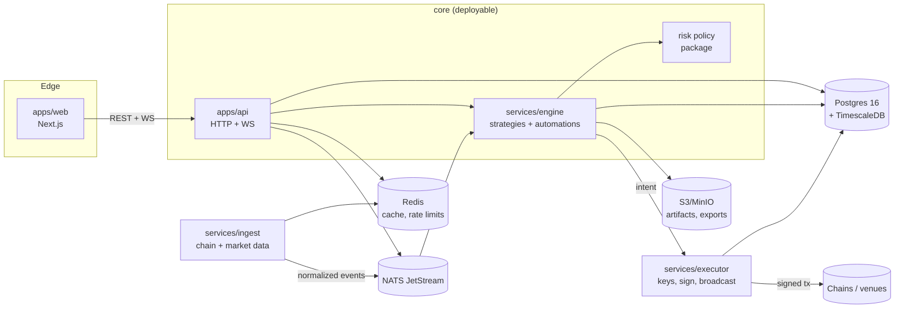
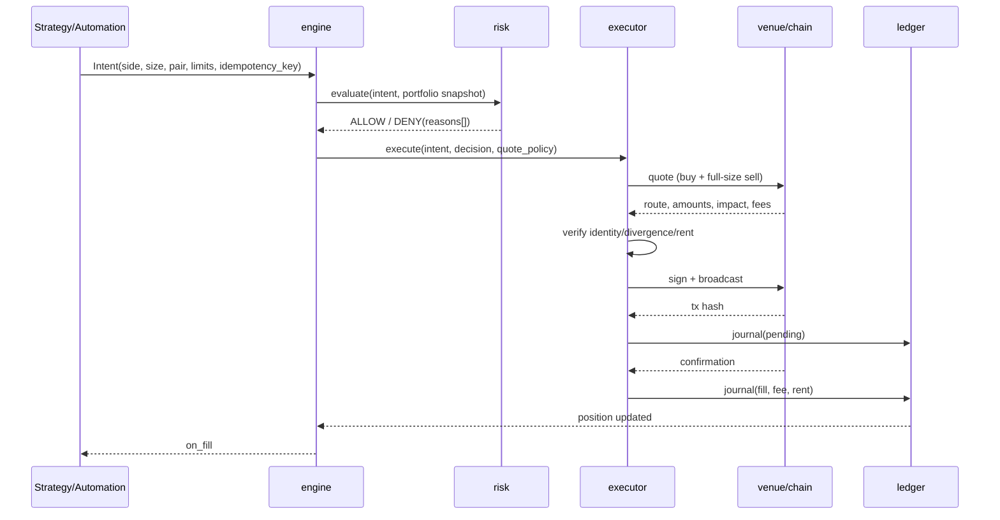

# ARCHITECTURE — ezCHAIN

Status: design. No runtime code yet. This document is the contract every later PR
implements; deviations require an ADR.

## 1. Shape

**Modular monolith + two hard boundaries.** The core (API, engine, ingest workers) is one
deployable modular application with enforced package boundaries. The **executor** is a
separate process because it is the only key holder. The **ingest** workers can scale
separately because they are I/O-bound and chain-specific.



Why not microservices: v2 and v3 both described 9 services and shipped one process, so the
boundary was fiction; pumpbot's monolith made iteration fast but concurrency unsafe. A
modular monolith with real import boundaries and one separately-scaled executor gets the
iteration speed without lying about the topology.

## 2. Deployables

| Deployable | Language | Responsibility | Scaling |
|---|---|---|---|
| `apps/web` | TypeScript / Next.js | UI, routing, formatting, WS client | stateless, N |
| `apps/api` | Python 3.12 / FastAPI | auth, REST, WS gateway, read models, command API | stateless, N |
| `services/engine` | Python | strategy runtime, automation scheduler, signal routing, risk | 1 per workspace partition |
| `services/executor` | Python | key custody, signing, broadcast, fill confirmation | 1 per key shard |
| `services/ingest` | Python (Rust only if measured) | market/chain streams, normalization, candles | per source, N |
| `migrate` | Python | one-shot Alembic | run-to-completion |

Single-node default = one `core` container (api+engine) + `executor` + `ingest` + data
services. The same images scale out unchanged.

## 3. Module map (monorepo)

```
apps/
  web/                     # Next.js 15, App Router, Tailwind, TanStack Query
  api/                     # FastAPI edge
services/
  engine/                  # strategy host, automation scheduler, signal router
  executor/                # vault, signer, broadcaster, confirmer
  ingest/                  # sources/{chain,venue,cex,social}, normalizers, candles
packages/
  core_py/                 # domain: money, ledger, orders, positions, risk policy
  sdk_py/                  # public strategy/automation SDK (Apache-2.0)
  adapters/
    chain_solana/ chain_evm/ chain_move/ chain_cosmos/ chain_bitcoin/ chain_ton/ ...
    venue_jupiter/ venue_uniswap/ venue_pancake/ venue_oneinch/ venue_cex/
  ui/                      # design tokens + primitives shared by web
  contracts/               # OpenAPI + event schemas (generated, checked in)
tools/                     # gates, generators
design/                    # wireframe + brief (source of truth for visuals)
infra/                     # compose, Caddy, Prometheus, Grafana
```

Enforced boundaries (import-linter):

- `core_py` imports nothing from `apps/`, `services/`, `adapters/`, `sdk_py`.
- `apps/api` never imports `services/executor`; only the executor HTTP client.
- `adapters/*` import `core_py` and their chain SDK; never another adapter.
- `sdk_py` imports only `core_py` types (no platform internals).
- `services/engine` never touches key material or signing libraries.

Module size budget: ≤ 800 LOC per module, ≤ 400 LOC per file outside generated code. A
module that needs more is two bounded contexts. (v3's 697 KB `service.py` is the counter-
example.)

## 4. Data flow

### 4.1 Market data

`ingest` connects to RPC/WS/REST per source → normalizes into `MarketEvent`
(`chain, venue, pair, price, liquidity, volume, fees, source, observed_at, units`) →
publishes to NATS `market.*` → engine consumes; API serves snapshots; candles are
materialized into Timescale hypertables.

Rules: every event declares units and freshness; a late event is flagged, not silently
reordered; duplicate `(source, pair, observed_at)` is idempotent.

### 4.2 Order



Idempotency: `intent_id` is unique; executor dedupes by it; a retry after a timeout
queries the chain before re-signing. Every state change is an event, every event is
persisted before side effects (outbox).

### 4.3 Valuation

`PositionView` is assembled by one projector from ledger + market events. It carries
`mark_status`, `mark_age`, `source`, and `paper|live`. The UI formats, never computes.
Stale mark → label, not a stale number presented as live.

## 5. Persistence

- **Postgres 16** is the only source of truth.
- **TimescaleDB** hypertables for ticks/candles with retention (raw 7–30 d, 1m 1 y).
- **Outbox** table written in the same tx as domain state; a relay publishes to NATS.
- **NATS JetStream** for fan-out, durable consumers, dead-letter queue; not a database.
- **Redis** only for cache, rate limits and ephemeral locks. Loss of Redis never loses money.
- **S3/MinIO** for backtest artifacts, model files, exports; content-addressed.
- **No money state in JSON files, process memory or volumes.** (v2's paper wallet JSON is
  the counter-example.)

## 6. Events and schemas

`packages/contracts/events/*.json` (versioned, generated from Pydantic):

| Event | Key fields |
|---|---|
| `market.tick` | chain, venue, pair, price, liq, source, observed_at, units |
| `intent.created` | intent_id, strategy_id, side, size, limits, mode |
| `risk.decided` | intent_id, decision, reasons[], snapshot_hash |
| `order.submitted` | order_id, route_id, tx_hash, quote_envelope |
| `order.filled` | order_id, filled_amount, effective_price, fees, rent |
| `position.changed` | position_id, state, ledger_seq |
| `wallet.synced` | wallet_id, chain, block, balance_delta |
| `automation.fired` | automation_id, rule_id, action, result |
| `alert.raised` | severity, type, entity, dedupe_key |

Schemas are additive; consumers ignore unknown fields; breaking changes get a new
`vN` topic and a migration window.

## 7. Reliability

- **At-least-once delivery**, idempotent handlers, dead-letter review page in ops.
- **Backpressure**: bounded queues; ingest drops with a counter when the consumer lags,
  never blocks the chain reader.
- **Circuit breakers** per source/venue with half-open probes; breaker state is visible.
- **Graceful shutdown**: stop accepting intents, drain in-flight orders, persist, exit.
- **Restart safety**: no in-memory open position; executor reconciles open orders on boot
  from DB + chain, and closes/replays orphaned intents explicitly.
- **Clock**: all timestamps UTC, DB `timestamptz`; decisions store the observation time.

`executor` is the only service allowed to write `ledger_entries` for fills; engine writes
only intent/decision rows. Ledger accounts: `wallet:<id>`, `strategy:<id>`,
`fees:<chain>`, `pnl:realized`, `pnl:unrealized` (view only).

## 8. Configuration

One Pydantic settings schema, layered: defaults < `ezchain.toml` < env < workspace DB
overrides (audited). No module-level constants. Secrets are references (`vault://…`,
`env://…`), resolved only in the executor or the relevant adapter. The web app receives
a sanitized `/config/public` projection.

## 9. Observability

- OpenTelemetry traces across API → engine → executor → venue, with `intent_id` as the
  correlation key.
- Prometheus metrics: intent rate, decision latency, quote latency, fill ratio, slippage
  realised vs quoted, ledger drift gauge, queue depth, source freshness, breaker state.
- Structured JSON logs, redacted by key-pattern allowlist.
- Audit log table (append-only) for config, keys, wallets, manual orders, kill switch.
- Ops page in the product mirrors those signals; Grafana is optional.

## 10. Testing strategy

| Layer | Gate |
|---|---|
| Core | property tests: ledger balances, money rounding, risk monotonicity |
| Adapters | shared contract suite per chain/venue + recorded fixtures |
| Strategies | SDK conformance suite + sandbox escape tests |
| Engine | deterministic replay: same events ⇒ same decisions |
| API | OpenAPI schema diff, authz matrix, rate limits |
| UI | component tests + one Playwright smoke per page |
| System | compose smoke: boot, paper trade, kill switch, restore backup |
| Nightly | soak: 24 h ingest + 10k paper intents; invariant check |

A PR merges only when `tools/ci.sh` is green; the system smoke runs before release.

## 11. Extension points

1. **Chain adapter** — `ChainAdapter` (accounts, balances, transfer build, confirmation,
   fee, address validation, capability flags).
2. **Venue adapter** — `VenueAdapter` (quote, build swap, simulate, broadcast).
3. **Strategy plugin** — `Strategy.on_*` returning intents; manifest with params schema,
   required capabilities, chains, venues and data scopes.
4. **Automation action** — a typed action registered by the platform (notify, rebalance,
   pause strategy, DCA, close position) + a user-composable rule.
5. **Signal source** — emits `Signal` with provenance; can be routed to strategies.

All extension points are versioned, permissioned and loaded by the same plugin loader.
