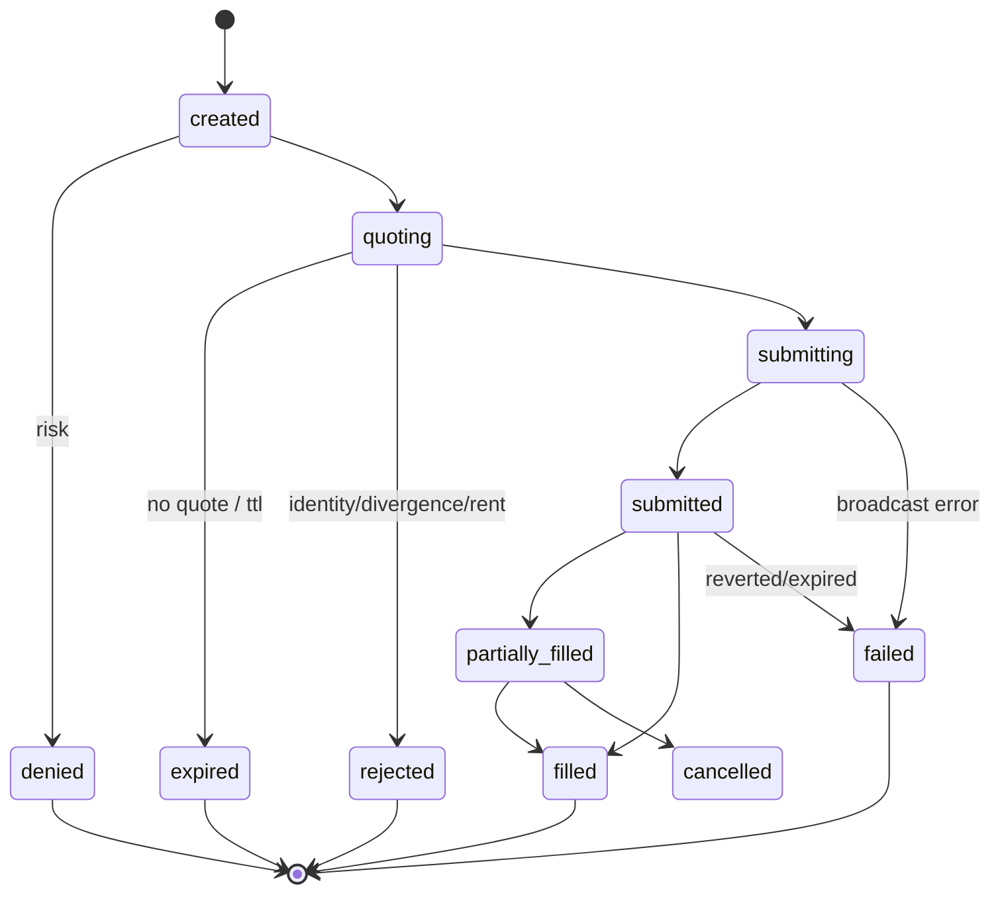
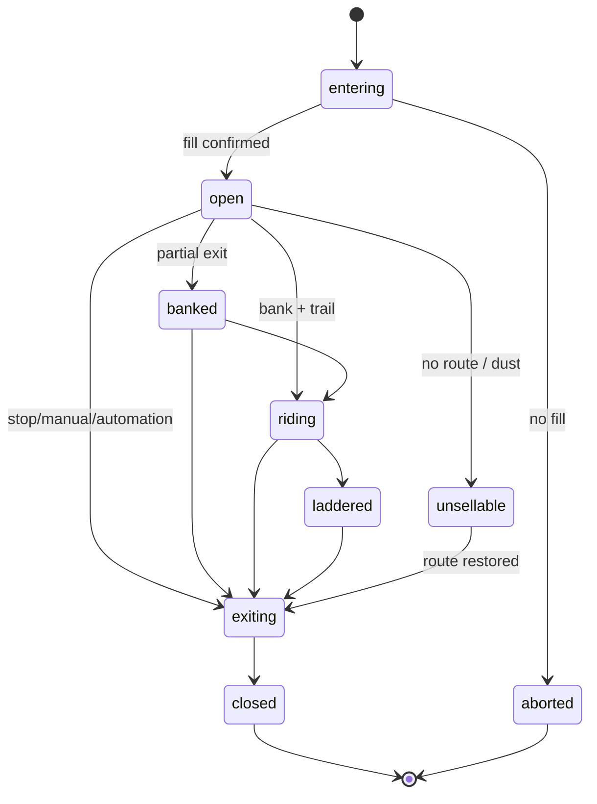

# DOMAIN MODEL — ezCHAIN

Normative entities and state machines. Every runtime package implements these names;
the API schema is generated from them.

## 1. Tenancy

```
Workspace 1─* Member(user, role)
Workspace 1─* Wallet
Workspace 1─* StrategyInstall ── StrategyVersion
Workspace 1─* Automation ── AutomationRun
Workspace 1─* Position / Order / Alert / Backtest
```

Roles: `owner` (billing, keys, members), `trader` (orders, automations), `viewer`
(read-only). Personal install = one workspace; the UI hides the concept until a second
member is invited.

## 2. Money and units

- `Money` = integer minor units + ISO-4217 currency (`USD`, `EUR`). Never float.
- `TokenAmount` = raw integer string (u128-safe) + `decimals` + `mint`. Display formats;
  math uses raw units with explicit decimals.
- `Price` = `Decimal` with a declared quote (`USD`, `SOL`, `ETH`, …).
- Market events carry `units: {base, quote, scale}` and are rejected if a consumer's
  expected units differ. No implicit lamports/token-unit coercion (v3 incident).
- Rounding: half-even, at presentation only. Persist full precision; quantize at the
  adapter boundary with a recorded `qty_rounding` reason.

## 3. Entities

### Wallet

| Field | Notes |
|---|---|
| `id`, `workspace_id`, `label`, `kind` | `hot` \| `watch` \| `hardware` \| `exchange` |
| `chains[]` | derived from accounts |
| `address` per chain | one wallet may have several chain accounts |
| `custody` | `local_vault` \| `ledger` \| `cex_key` \| `none` |
| `policy` | spend caps, allowlist, allowed venues, require-approval threshold |
| `status` | `active` \| `paused` \| `revoked` \| `unsynced` |
| `last_synced_at`, `sync_block` | per chain |

A wallet never stores a balance. Balances are `SUM(ledger_entries)` per asset account,
plus a chain-sync adjustment entry when reality diverges (with reason).

### StrategyInstall

| Field | Notes |
|---|---|
| `id`, `plugin_id`, `version`, `source` | local path \| signed package \| git |
| `params` | validated against the plugin's JSON Schema |
| `chains[]`, `wallets[]`, `venues[]` | explicit grants |
| `mode` | `paper` \| `live`, with `paper_gate` evidence |
| `status` | `installed` \| `paper` \| `live` \| `paused` \| `quarantined` |
| `limits` | max notional/day, max positions, max leverage (none for spot) |

A strategy has **no** direct key or network access. It emits intents through the host
API; the host applies risk and execution.

### Automation

A versioned rule: `trigger`, `conditions[]`, `actions[]`, `scope`, `cooldown`, `mode`.

Triggers: schedule (cron), price level, PnL threshold, drawdown, signal match, wallet
activity, chain event, webhook, manual. Actions: open/close/scale, DCA, rebalance,
pause/resume strategy, notify, webhook, set risk limit. Each run stores its inputs and
the resolved action; runs are idempotent by `(automation_id, trigger_key)`.

### Intent → Order → Fill

| Entity | Key fields |
|---|---|
| `Intent` | id, strategy/automation, wallet, chain, venue, base/quote, side, size, limit price, slippage cap, ttl, idempotency_key, mode, reason |
| `RiskDecision` | intent_id, allow/deny, reasons[], snapshot_hash, limits applied |
| `Quote` | buy quote, full-size sell quote, route_id, expected out, min out, impact, fees, source, observed_at, ttl |
| `Order` | intent_id, quote_id, state, tx_hash, nonce, submitted_at |
| `Fill` | order_id, filled_base, filled_quote, effective_price, fee, rent, venue, tx_hash, confirmed_at |

### Position

A position is a projection, not a mutable truth: derived from fills and marks.

| Field | Notes |
|---|---|
| `id`, `wallet_id`, `strategy_id`, `chain`, `token` | identity |
| `state` | see state machine |
| `size_raw`, `cost_basis_usd`, `realized_pnl_usd` | from ledger |
| `mark` | price, source, age, status (`live` \| `delayed` \| `entry_fallback` \| `no_route` \| `dust`) |
| `peak_price`, `mfe_pct`, `mae_pct` | from persisted observations |
| `exit_plan` | stop, trail, bank, ladder rungs, max hold — immutable per position version |
| `ladder_state` | pre-bank, banked, riding, laddered |

### Signal

`id, source, chain, token/pair, kind (flow|price|wallet|social|onchain|model),
score, confidence, evidence{}, observed_at, ttl, dedupe_key`.
Signals are **inputs**, never orders. Routing rules map signal → strategy/automation.

### Backtest

`id, strategy_version, params, universe, window, data_snapshot_id, fee_model,
slippage_model, fill_model, seed, status, metrics{}, equity_curve_ref, trades_ref`.
A result is immutable; comparisons are between result ids, never recomputed on the fly.

### Alert / Notification

Alert = condition + severity + dedupe key + entity. Notification = delivery attempt per
channel with status and retry count. Channels: in-app, email, Telegram, Discord, webhook.

### AuditEvent

Append-only: actor, action, entity, before/after hash, ip/session, timestamp. Covers
config, keys, wallet changes, manual orders, mode switches, kill switch, plugin installs.

## 4. State machines

### Intent



Every transition writes an event with `reason`; `failed`/`rejected` always carry a
machine-readable code and human message.

### Position



`unsellable` is a first-class state (v3 lesson): keep the mark, show `NO SELL ROUTE`, do
not pretend the position is flat or that the last quote is executable.

### Wallet / Strategy / Automation

- Wallet: `active ⇄ paused → revoked`; `unsynced` when chain sync fails (alerts, blocks
  new intents from that wallet).
- Strategy: `installed → paper → live ⇄ paused → quarantined` (invariant breach or
  manual); `quarantined` requires an explicit owner action to leave.
- Automation: `draft → active ⇄ paused → archived`; each run: `pending → running →
  succeeded | skipped | failed` with a reason.

## 5. Ledger model

Double-entry, append-only, per workspace.

Accounts: `asset:<chain>:<mint>` (wallet custody), `position:<position_id>`,
`income:fees`, `expense:fees`, `equity:realized`, `equity:unrealized` (memo only),
`external:<chain>` (on-chain inflow/outflow), `exchange:<venue>`.

Every journal entry: `entry_id, tx_id, account, asset, amount_signed, seq, created_at,
reason, ref_type, ref_id`. A transaction must sum to zero across accounts.

**Buy 1 SOL of TOKEN with 0.001 SOL fee:**

| account | asset | amount |
|---|---|---|
| `position:<id>` | TOKEN | +raw_tokens |
| `asset:solana:<mint>` | TOKEN | −raw_tokens (custody) |
| `asset:solana:SOL` | SOL | −(1.0 + 0.001) |
| `expense:fees` | SOL | +0.001 |

**Sell half:** reverse the token leg, credit SOL net, move basis to `equity:realized`.
The position's `cost_basis_usd` is derived, never stored independently.

**Chain sync adjustment:** if on-chain balance differs from the ledger, write an
`adjustment` entry with `reason=chain_reconcile`, alert, and block new intents until
reviewed. Never silently overwrite a balance.

## 6. Invariants (testable)

1. `SUM(ledger_entries.amount) = 0` per journal `tx_id`.
2. `balance(account) = SUM(amount)` for every account; no balance table.
3. `size_raw(position) = SUM(token legs)`; `realized = SUM(realized legs)`.
4. A position cannot be `closed` with non-zero remaining tokens.
5. A fill references exactly one quote and one order; an order exactly one intent.
6. `intent.idempotency_key` is unique per workspace.
7. No intent exists without a `RiskDecision`.
8. Every `live` intent has a paper-gate record for the strategy version.
9. Mark timestamps are monotonic per (pair, source); late events are flagged.
10. `AuditEvent` count only grows; no update/delete grants at the DB role level.

## 7. Naming

`snake_case` in Python/DB, `camelCase` in API JSON, `kebab-case` in URLs, `SCREAMING_SNAKE`
for enum wire values. Money fields end in `_usd`/`_raw`/`_price`; durations end in `_s`;
timestamps are `*_at` in UTC.
