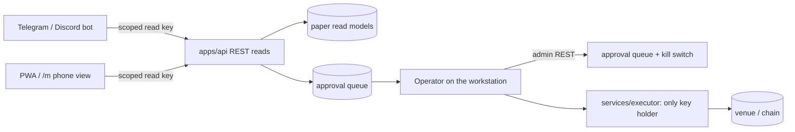

# REMOTE SURFACES — phone, VPS and chat

A phone or a chat client connects to a workstation that the user owns. The boundary is the
same on every one of them: **notifications and read-only views first; execution only through
the approval gate, and never through a remote key**. The reason is the key boundary, not
convenience: keys live only in `services/executor` (CONTRACT I4, ADR-0040), and a surface that
can sign from a phone or a VPS has turned a lost device into a lost account. This document
describes that boundary, the surfaces that exist, and the ones that are still a design.

## 1. What exists today

| Surface | State | Evidence |
|---|---|---|
| Workstation web UI | built, paper read/write with approvals | `apps/web`, `apps/api`, `apps/mcp` |
| Phone-sized read-only workspace at `/m` | built | `apps/web/app/m/page.tsx`; force-dynamic, reads `getPaperSnapshot()`, `getPaperFills(5)` and `getKillSwitch()`, renders panels only, no order form |
| Mobile reference gallery at `/mobile` | built as a development reference, not a client | `apps/web/app/mobile/page.tsx:17` calls `notFound()` unless `referenceSurfacesEnabled()`; its own "Not a native app" panel (lines 245–250) says there is no iOS/Android build, push notification or offline cache |
| Native iOS / Android app | not built; out of scope for v1 | `ROADMAP.md` "Explicitly out of scope for v1" |
| PWA install, service worker, push | not built | no manifest or service-worker file under `apps/web`; no push code under `apps/` or `services/` |
| MCP read surface for external agents | built | `apps/mcp`, documented in [`AGENT-INTEGRATION.md`](AGENT-INTEGRATION.md) |
| Telegram / Discord / email / webhook delivery | named as channels, not implemented | [`DOMAIN-MODEL.md`](DOMAIN-MODEL.md) §3 "Alert / Notification"; no client code under `apps/` or `services/` |

The responsive shell is the same Next.js app at a narrow viewport: the sidebar becomes a
bottom nav and tables scroll. `/mobile` documents those rules as a fixture gallery; `/m` is
the real read-only workspace. Neither is a native client.

## 2. Remote-access architecture

**Read path.** A remote surface holds a scoped `read` key and calls the same REST reads an
agent uses (`/api/v1/agent/state`, `/api/v1/agent/capabilities`, the paper account, positions,
fills and ledger routes). Reads are open on a self-hosted workspace by default; a hosted
deployment sets `EZCHAIN_REQUIRE_AUTH_FOR_READS=true`, after which every read needs the key
([`AGENT-INTEGRATION.md`](AGENT-INTEGRATION.md) §1, §4). Every number is server-computed and
carries its source, age and mode; a remote view formats it and never recomputes PnL
(CONTRACT I10).

**Execution path.** A remote surface cannot place a fill. A paper order written by any
non-operator principal lands in the durable approval queue with `status: "pending_approval"`
and a person decides it over REST on the workstation; an agent key cannot approve its own
order (`403 APPROVAL_REQUIRES_PERSON`) and cannot raise its automation tier
([`AGENT-INTEGRATION.md`](AGENT-INTEGRATION.md) §3, ADR-0041). Remote "kill switch" means
state and, where a narrow scope is added for it, arming. Releasing the switch, reloading
plugins and minting keys stay admin REST operations on the workstation; they have no MCP tool
and no chat command. A remote surface never holds a venue key, a `KeyHandle`, the deployment
admin token or the executor vault.

**Notification path.** The model in [`DOMAIN-MODEL.md`](DOMAIN-MODEL.md) §3 is one alert
(condition + severity + dedupe key + entity) and one notification per delivery channel with
status and retry count; the channels are in-app, email, Telegram, Discord and webhook. The
source of an alert is already bounded: a stale source raises one `provider_stale` alert per
`(chain, token, kind)` transition, and `GET /paper/alerts` drains a bounded queue
([`ARCHITECTURE.md`](ARCHITECTURE.md) §4.1). The delivery channels are not implemented, so
this is the contract a future adapter must satisfy, not a working notifier. Delivery must
never be the only record of an alert: the in-app surface keeps the alert, and a failed chat
delivery is a notification status, not a lost alert.

## 3. Telegram bot (planned)

The bot is an alert and inspection client, never a signer. Its three jobs:

- **Alerts.** Forward deduplicated, redacted alert text from the existing alert stream to a
  chat. No market text is an instruction; a message that looks like an order is data, never a
  command (tool poisoning, [`AGENT-INTEGRATION.md`](AGENT-INTEGRATION.md) §8).
- **Position status.** Read the account and positions and answer with the server's numbers,
  their source and their age. An unknown mark is reported as unknown, never as zero, and a
  stale mark is labelled stale.
- **Kill switch.** Report the persisted state, reason and update time. Arming from chat is a
  fail-safe only and needs a narrow arm-only scope that cannot release the switch, change a
  key's scopes, reload a plugin or sign; that scope does not exist today (the scopes are
  `read`, `trade` and `admin`, [`AGENT-INTEGRATION.md`](AGENT-INTEGRATION.md) §4), so remote
  arming is blocked on code and its own ADR rather than assumed here.

The bot holds one scoped key in the operator's secret store, not in a chat message, a log or a
model context. It has no trade scope, no order tool and no approval tool. It cannot sign a
transaction, broadcast one, or change an approval: those stay in the executor and behind the
person at the workstation. Discord delivery uses the same boundary.

## 4. Mobile and PWA decision

The decision is a responsive PWA, not native apps, for the same reason the workstation is the
trust boundary: the client is a view, and a view does not need a signed binary or a store
account to stay honest. `/m` is the built read-only view; a PWA manifest, service worker and
push would be added to that surface, not to a second app. The same boundary holds: a pushed
alert may say "an order is waiting", but the approval is given on the workstation. Offline
caching, if added later, caches read models with their observation time and never caches an
approval decision or a key. No service worker, manifest, push subscription or native build
exists today, so none of that is claimed as working.

## 5. VPS deployment guide

A live workstation is the user's own VPS with the user's own keys, installed by the official
installer the user runs. ezCHAIN does not hold, store or sign with user keys and does not get
access to the user's server. That is the owner's hosting decision of 2026-11-11, recorded in
the private monetization note and reflected in the free-offer policy in
[`FUNDING.md`](FUNDING.md). The install, firewall, secrets, TLS, backup and the list of what
was actually tested are already written in [`SELF-HOSTING.md`](SELF-HOSTING.md); this section
adds the hardening checklist for *remote* access and does not repeat that guide.

- [ ] The API and MCP server bind `127.0.0.1`; the edge terminates TLS and publishes only the
      routes the operator needs. `/metrics`, `/healthz` and the OpenAPI docs stay loopback or
      operator-token, never public ([`ARCHITECTURE.md`](ARCHITECTURE.md) §9).
- [ ] The firewall admits 443 and SSH from known addresses only; SSH uses key auth with
      password login disabled.
- [ ] The installer is a pinned, tagged release whose checksum is verified before extract
      ([`SELF-HOSTING.md`](SELF-HOSTING.md) §5). No image ships a prebuilt secret.
- [ ] Each remote client gets its own scoped key. Bots get `read` only; no deployment token,
      `admin` key or venue credential is copied to a phone, a chat config or a VPS shell
      history.
- [ ] The executor's vault is the only key store; its file is in the encrypted backup and no
      key appears in a snapshot, a trace, a chat message or a provider marketplace image.
- [ ] The kill switch is armed and released by the operator on the workstation; a chat client
      can only read it until a narrow arm-only scope exists.
- [ ] Audit rows for approvals, mode changes and key changes are reviewed on a schedule;
      a remote surface cannot write them directly.
- [ ] Backups are restored and checked with the drill in
      [`SELF-HOSTING.md`](SELF-HOSTING.md) §11 before any remote surface is relied on.
- [ ] The deployment stays PAPER until [`PRODUCTION-READINESS.md`](PRODUCTION-READINESS.md)
      is satisfied by measurement. A remote view that says "live" without that gate is a false
      claim.

## 6. Not built, so not claimed

Telegram, Discord, email and webhook delivery; a PWA manifest, service worker or push; remote
kill-switch arming; native mobile apps; and any remote signing path are all absent from the
code today. The files that would hold them are named above only to say what they contain now.
This document is the boundary those features must keep when they are built; it is not evidence
that they work.
