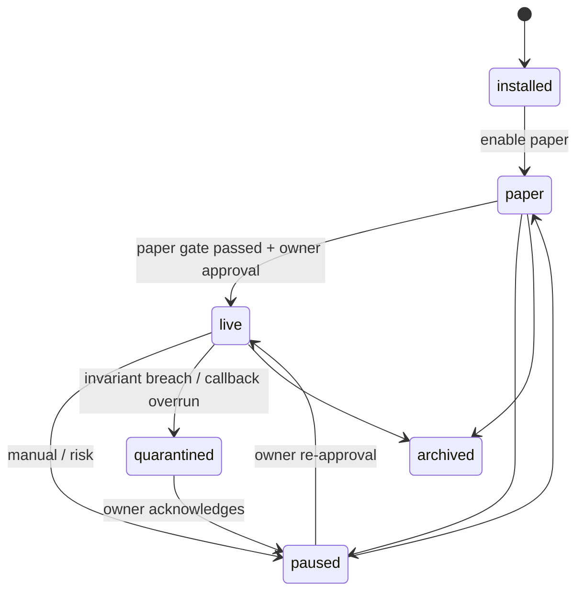

# STRATEGY SDK — the plugin contract

ezCHAIN ships **no strategies**. A strategy is an external package the user installs. The
SDK is the only stable surface; everything else is internal and may change between minor
versions.

SDK license: Apache-2.0 (so strategies can be any license). The app is AGPL-3.0.

## 1. Package shape

```
my_strategy/
  pyproject.toml          # depends on ezchain-sdk>=1,<2
  ezchain.plugin.json     # manifest (or [tool.ezchain] in pyproject)
  my_strategy/__init__.py
  my_strategy/strategy.py
  tests/
```

```json
{
  "id": "com.example.momentum",
  "name": "Momentum",
  "version": "1.2.0",
  "sdk": ">=1,<2",
  "entrypoint": "my_strategy.strategy:Momentum",
  "description": "Enters on N-bar momentum, exits on trail.",
  "author": "…",
  "license": "MIT",
  "chains": ["solana", "base"],
  "venues": ["jupiter", "uniswap"],
  "capabilities_required": ["swap", "quote_sell"],
  "data_scopes": ["candles:1m", "trades:own", "positions:own"],
  "permissions": ["read_market", "submit_intent"],
  "params_schema": {
    "type": "object",
    "properties": {
      "lookback": {"type": "integer", "minimum": 5, "default": 20},
      "risk_pct": {"type": "number", "minimum": 0.1, "maximum": 5, "default": 1.0}
    },
    "required": ["lookback", "risk_pct"]
  },
  "ui": {"summary": "Momentum · 20 bars · 1% risk", "icon": "trend-up"}
}
```

The host validates the manifest, the SDK range, the params against the schema, and the
requested permissions. A plugin asking for an ungranted capability does not load.

## 2. The interface (v1)

```python
from ezchain_sdk import Strategy, Context, Intent, Candle, Position

class Momentum(Strategy):
    def on_start(self, ctx: Context) -> None:
        """Called once. Read params via ctx.params. No network, no keys."""

    def on_candle(self, ctx: Context, candle: Candle) -> list[Intent]:
        """Pure decision point: return intents, never orders."""

    def on_signal(self, ctx: Context, signal: Signal) -> list[Intent]: ...
    def on_fill(self, ctx: Context, fill: Fill) -> None: ...
    def on_timer(self, ctx: Context, now: datetime) -> list[Intent]: ...
    def on_stop(self, ctx: Context, reason: str) -> None: ...
```

Rules:

- **Intents only.** `Intent(side, pair, notional_usd | size_pct, limit_price?, slippage_cap,
  ttl_s, reason)`. The host does risk, quoting, sizing clamps and execution.
- **No I/O.** No network, no filesystem writes, no subprocess, no env. Market data and
  positions arrive as arguments; requests go through `ctx` read APIs.
- **Deterministic.** Same inputs ⇒ same intents. Time comes from `ctx.now`, randomness
  from `ctx.random(seed)`. No wall clock, no `random` module.
- **Idempotent.** The host may call `on_timer` twice after a restart; emit intents with
  stable `reason`/dedupe keys.
- **Bounded.** Each callback has a CPU/wall budget (default 50 ms / 250 ms); overruns
  quarantine the strategy version, not the platform.

## 3. Context API (read-only)

| Method | Returns |
|---|---|
| `ctx.params` | validated params object |
| `ctx.now` | host clock (UTC) |
| `ctx.candles(pair, tf, n)` | bounded history from the snapshot |
| `ctx.positions()` | own positions in this install |
| `ctx.balance()` | own strategy allocation, from ledger |
| `ctx.signals(since)` | signals routed to this strategy |
| `ctx.mode` | `paper` \| `live` |
| `ctx.random(seed)` | deterministic RNG |
| `ctx.log(level, msg, **fields)` | structured log, rate-limited |

No `ctx.wallet`, no `ctx.sign`, no `ctx.http`.

## 4. Lifecycle



**Paper gate (mandatory before live):** ≥ 14 calendar days, ≥ 100 intents, ≥ 20 fills,
no ledger/risk invariant breach, and a backtest on the same data window with declared fee
and slippage model. The gate result is stored and shown in the UI. It is a process gate,
not a profitability promise.

## 5. Isolation

- Each install runs in its own subprocess (`services/engine` supervisor), Python
  `-I -S` style isolated env, seccomp/bubblewrap on Linux, Job Object limits on Windows.
- Read-only FS, no network namespace (or an allowlist proxy for opt-in data APIs).
- Memory 512 MB default, CPU quota, wall-clock budget per callback.
- Crash ⇒ restart with backoff; 3 crashes in 10 min ⇒ quarantine + alert.
- Plugin code cannot import platform internals; the SDK is the only import path.

## 6. Allocation and sizing

A strategy receives an allocation (`max_notional_usd`, `max_positions`,
`max_daily_loss_usd`). The host sizes intents:

`size = min(strategy_intent, allocation_headroom, risk_policy_max, liquidity_cap)`

The strategy never sees the wallet balance beyond its allocation. Sizing math is platform
code, tested once (v2's tier-from-pWin sizing is the anti-pattern).

## 7. Backtesting contract

The same class runs in the backtester with a simulated clock and recorded market events.
The harness declares: data snapshot id, fee model, slippage model, fill model, latency
model. Results are immutable. A backtest that cannot be reproduced from its snapshot is
invalid.

Requirements for a strategy author: no reliance on wall clock, no look-ahead (the harness
only exposes events with `observed_at <= clock`), and no dependency on live-only fields.

## 8. Packaging and distribution

- `ezchain plugin build` → wheel + manifest + SHA-256 + optional sigstore signature.
- Local install: path or wheel upload. Registry install (opt-in): signed package index.
- Version pinning per install; upgrades require a params re-validation and, for live, a
  fresh paper gate if the manifest's `breaking` flag is set.
- Uninstall keeps the ledger history; positions can be adopted by a "manual" pseudo-
  strategy so nothing is orphaned.

## 9. Conformance suite (must pass)

1. Manifest validates; params schema rejects out-of-range.
2. Determinism: same event log twice ⇒ identical intents.
3. No I/O: socket/file/subprocess attempts fail the sandbox test.
4. Budget: a busy-loop callback is killed, not the host.
5. Idempotency: duplicate timer event ⇒ no duplicate intent.
6. Risk bypass: a huge notional is clamped, with a recorded reason.
7. Restart: state reconstructed from host, no self-persisted money state.
8. Backtest parity: paper replay of the same window matches the recorded intents.

## 10. What the platform will never do

- Auto-generate a strategy or tune parameters on the user's behalf without an explicit,
  versioned experiment record.
- Ship a "default" strategy that trades on install.
- Let a plugin request a private key, a raw signed transaction, or another user's data.
- Hide a losing live strategy behind paper metrics: mode is stamped on every number.
