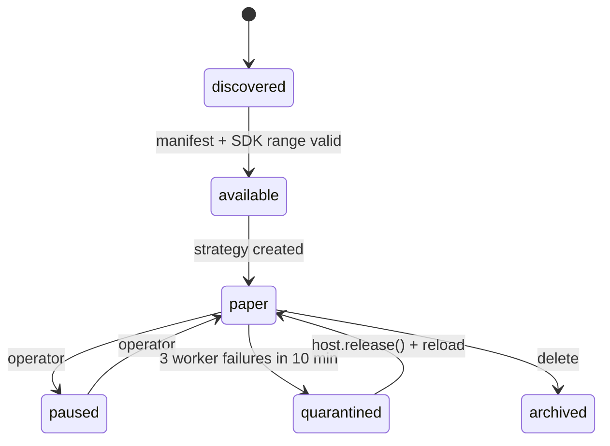

# STRATEGY SDK — the plugin contract (v1)

ezCHAIN ships **no strategies**. A strategy is an external package the user installs. The
SDK is the only stable surface; everything else is internal and may change between minor
versions.

- SDK package: `packages/sdk-py` (`ezchain-sdk`, Apache-2.0).
- Host: `services/engine` discovers, validates and supervises plugins.
- API: `apps/api` exposes the catalogue and plugin-strategy CRUD.
- Agent surface: `apps/mcp` exposes reads and paper-only mutations over MCP.

## 1. Package shape

```
my_strategy/
  pyproject.toml              # depends on ezchain-sdk>=1,<2
  ezchain.plugin.json         # required manifest
  my_strategy/__init__.py
  my_strategy/strategy.py
  tests/
```

`pyproject.toml`:

```toml
[project]
name = "my-strategy"
version = "1.2.0"
dependencies = ["ezchain-sdk>=1,<2", "numpy>=2", "scikit-learn>=1.5"]

[project.entry-points."ezchain.strategies"]
my-strategy = "my_strategy.strategy:Momentum"

[tool.setuptools.package-data]
my_strategy = ["ezchain.plugin.json"]
```

Place `ezchain.plugin.json` at the repository root **and** include it as package data
inside `my_strategy/` (or ship it as a data file). The host searches the distribution for
the manifest, so either location works in a wheel. A directory dropped under
`EZCHAIN_PLUGIN_PATHS` only needs `ezchain.plugin.json`; its parent is added to the
worker's `sys.path`.

## 2. Manifest

```json
{
  "id": "com.example.momentum",
  "name": "Momentum",
  "version": "1.2.0",
  "sdk": ">=1,<2",
  "entrypoint": "my_strategy.strategy:Momentum",
  "description": "Enters on N-bar momentum, exits on a trail.",
  "author": "…",
  "license": "MIT",
  "homepage": "https://example.com/momentum",
  "chains": ["solana", "base"],
  "venues": ["jupiter", "kyberswap"],
  "capabilities_required": ["quote_sell"],
  "data_scopes": ["candles:1h", "positions:own"],
  "permissions": ["read_market", "read_account", "submit_intent"],
  "params_schema": {
    "type": "object",
    "properties": {
      "lookback": {"type": "integer", "minimum": 5, "default": 20},
      "risk_pct": {"type": "number", "minimum": 0.1, "maximum": 5, "default": 1.0},
      "entry_pct": {"type": "number", "minimum": 0, "default": 1.0}
    },
    "required": ["lookback"],
    "additionalProperties": false
  },
  "primary_timeframe": "1h",
  "timeframes": ["1h"],
  "context_bars": 200,
  "modes": ["paper"],
  "ui": {"summary": "Momentum · 20 bars · 1% risk", "icon": "trend-up"}
}
```

Validation rules enforced before import:

- `id` is 3–128 lowercase letters, digits, `.`, `_` or `-`.
- `version` is semantic; `sdk` is a PEP 440 specifier that must include the host SDK
  (`1.0.0`).
- `entrypoint` is exactly `module.path:ClassName`.
- `permissions` is a subset of `read_market`, `read_account`, `submit_intent`.
- `modes` must include `paper`; `live` is declared but not executable in v1.
- `timeframes` and `primary_timeframe` use `1m`, `5m`, `15m`, `1h`, `4h`, `1d`.
- `context_bars` is 2–1000.
- Unknown top-level keys are rejected (`x-*` extension keys are allowed).

The parameter schema supports `type`, `properties`, `required`,
`additionalProperties`, `enum`, `const`, `minimum`, `maximum`, `exclusiveMinimum`,
`exclusiveMaximum`, `multipleOf`, `minLength`, `maxLength`, `pattern`, `items`,
`minItems`, `maxItems`, `uniqueItems`, `anyOf`, `oneOf`, `allOf` and defaults. Every
other keyword is refused rather than silently ignored. An object with `properties`
rejects unknown keys unless it explicitly sets `additionalProperties: true`.

## 3. The interface

```python
from ezchain_sdk import Candle, Context, Fill, Intent, Signal, Strategy

class Momentum(Strategy):
    def on_start(self, ctx: Context) -> None:
        ctx.state.setdefault("last_side", None)

    def on_candle(self, ctx: Context, candle: Candle) -> list[Intent]:
        bars = ctx.candles_for("1h", 21)
        if len(bars) < 21:
            return []
        change = (bars[-1].close / bars[0].close - 1) * 100
        if change >= ctx.params["entry_pct"] and ctx.state["last_side"] != "buy":
            ctx.state["last_side"] = "buy"
            return [Intent(side="buy", notional_usd="25", reason="MOMENTUM_ENTRY")]
        return []
```

Callbacks:

| Callback | When |
|---|---|
| `on_start(ctx)` | once per worker lifetime, before the first tick |
| `on_candle(ctx, candle)` | when the manifest has a `primary_timeframe` and a closed bar exists |
| `on_timer(ctx)` | when there is no `primary_timeframe` |
| `on_signal(ctx, signal)` | reserved; no signal router is enabled in v1 |
| `on_fill(ctx, fill)` | reserved; fills are visible through the next context |
| `on_stop(ctx, reason)` | best effort before the worker exits |

Rules:

- **Intents only.** `Intent(side, notional_usd, reason, dedupe_key?)` is a request. The
  host owns risk, sizing, quoting, routing, execution and accounting.
- **One order intent per tick.** A list with more than one intent is refused with
  `PLUGIN_MULTIPLE_INTENTS`; the tick is recorded as a hold.
- **No reserved execution fields.** `limit_price`, `ttl_s` and `size_pct` are rejected
  with `PLUGIN_UNSUPPORTED_INTENT` rather than silently ignored.
- **State is JSON.** `ctx.state` is persisted with the run (`inputs.plugin_state`) and
  replayed on the next tick. The worker may also return `Strategy.state()`; it is merged
  into `ctx.state`. Limit: 64 KiB.
- **No wallet, key, signing, HTTP or database API** exists in the SDK.
- **No wall clock.** `ctx.now` is the host clock. Randomness comes from
  `ctx.random(seed)`.

## 4. Context API

| Member | Returns |
|---|---|
| `ctx.params` | validated plugin config (schema defaults applied) |
| `ctx.state` | mutable replayable state for this strategy |
| `ctx.now` | host clock (UTC) |
| `ctx.mode` | `paper` (v1 never constructs a live context) |
| `ctx.candles_for(tf, n)` | last `n` closed bars, oldest first |
| `ctx.snapshot` | token snapshot, or `None` without `read_market` |
| `ctx.position` | this token's position, or `None` without `read_account` |
| `ctx.positions` | account positions, or `()` without `read_account` |
| `ctx.account` | cash/equity/PnL, or `None` without `read_account` |
| `ctx.allocation` | `max_notional_usd`, `max_positions`, `max_daily_loss_usd` |
| `ctx.log(level, msg, **fields)` | bounded structured log returned to the host |
| `ctx.random(seed)` | deterministic `random.Random` |

Unknown is not zero: a missing mark, candle or account field is `None`/empty, never
fabricated.

## 5. Lifecycle and modes



The platform is paper-only today. `EZCHAIN_EXECUTION_MODE=live` is refused at boot until
the executor ships. A strategy's paper-to-live readiness is computed from orders,
backtests and reconciliation by `GET /api/v1/strategies/{id}/live-readiness`; the endpoint
never promotes anything.

## 6. Isolation and trust

Each plugin strategy gets a supervised worker process:

- separate interpreter, `start_new_session`, no inherited API token or signing secret;
- scrubbed environment (`PATH`, locale, `TZ`, `PYTHONHASHSEED`, no `HOME`);
- `RLIMIT_AS` memory cap (default 512 MiB) and `RLIMIT_CPU` cap;
- per-callback wall timeout (default 5 s), then the process group is killed;
- 3 failures in 10 minutes quarantine the strategy; `POST /api/v1/plugins/reload` retires
  workers after an operator fixes the plugin;
- plugin stdout is redirected to stderr; only JSON lines on the protocol pipe are read.

**This is containment, not a security sandbox.** A plugin can still read the filesystem
and open sockets. Install only code you trust, review the manifest permissions, and keep
the API process in its own container/account. A future bwrap/seccomp profile is tracked
separately; do not describe the current worker as a sandbox.

## 7. Allocation and sizing

A strategy receives an allocation (`max_notional_usd`, `max_positions`,
`max_daily_loss_usd`) and returns a notional. The host clamps:

`size = min(intent_notional, allocation_headroom, risk_policy_max, liquidity_cap)`

The strategy never sees the wallet or the whole account beyond its `read_account` grant.
Sizing math is platform code, tested once.

## 8. Install and operate

```bash
# installed package
pip install ./my-strategy
curl -X POST -H "Authorization: Bearer $EZCHAIN_API_TOKEN" \
  http://127.0.0.1:8000/api/v1/plugins/reload

# directory plugin
export EZCHAIN_PLUGIN_PATHS=/srv/ezchain/plugins
curl -X POST -H "Authorization: Bearer $EZCHAIN_API_TOKEN" \
  http://127.0.0.1:8000/api/v1/plugins/reload
```

Catalogue:

```bash
curl http://127.0.0.1:8000/api/v1/plugins
curl -X POST http://127.0.0.1:8000/api/v1/plugins/com.example.momentum/validate \
  -H 'content-type: application/json' -d '{"config":{"lookback":30}}'
```

Create a strategy. Host-owned fields live beside `config`; the manifest schema validates
`config` only:

```json
{
  "name": "SOL momentum",
  "chain": "solana",
  "token_address": "So11111111111111111111111111111111111111112",
  "token_symbol": "SOL",
  "kind": "plugin",
  "plugin_id": "com.example.momentum",
  "params": {
    "interval_minutes": 60,
    "max_position_usd": 500,
    "order_usd": 100,
    "config": {"lookback": 20, "risk_pct": 1.0, "entry_pct": 1.0}
  }
}
```

`plugin_version` is pinned from the installed manifest at creation. Upgrading a manifest
requires a params re-validation; a persisted config that no longer validates fails closed
with `PLUGIN_CONTEXT_UNAVAILABLE` before the worker starts.

## 9. Backtesting

The graph backtester (`POST /api/v1/backtests`) is the only backtest harness in v1. Plugin
backtesting is the next milestone; do not claim a plugin backtest result until it exists.
The replay contract it will inherit: same class, simulated clock, no look-ahead, declared
fee/slippage/fill/latency model, immutable result, mode label `BACKTEST`.

## 10. Conformance suite

A plugin should ship tests for:

1. manifest validates and the SDK range includes the host;
2. params schema rejects out-of-range/unknown config;
3. determinism: same context twice ⇒ identical intents;
4. state: a tick's returned state replays into the next tick;
5. no I/O assumptions: no wallet/key/HTTP access is available through the SDK;
6. budget: a busy loop is killed, not the host;
7. one intent: multiple intents are refused;
8. reserved fields are refused;
9. restart: state is reconstructed from `ctx.state`, not from process memory;
10. mode: the strategy never requests live and works with `ctx.mode == "paper"`.

## 11. What the platform will never do

- Auto-generate a strategy or tune parameters without an explicit, versioned experiment.
- Ship a default strategy that trades on install.
- Let a plugin request a private key, a raw signed transaction, another user's data or a
  client-supplied execution mode.
- Hide a losing live strategy behind paper metrics: every number carries `PAPER`,
  `BACKTEST` or `LIVE`.
