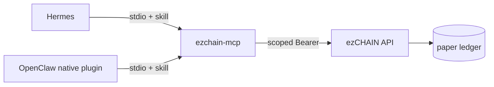

# Agent integration packs

> **ALPHA / PAPER ONLY.** These are local packs, not official Hermes/OpenClaw marketplace
> listings. Official publication is gated on real-mode readiness and upstream review; do
> not use them for real-money trading.

First-class packs for the two MCP-native agent harnesses. Both use the same
`apps/mcp` server and the same ezCHAIN REST API; only installation differs.

| Harness | Surface | Install |
|---|---|---|
| [Hermes Agent](https://github.com/NousResearch/hermes-agent) | `SKILL.md` + `mcp_servers` | `bash integrations/hermes/install.sh`, then `hermes mcp add` |
| [OpenClaw](https://github.com/openclaw/openclaw) | Agent Plugins 1.0.0 bundle: `plugin.json` + `mcp.json` + bundled skill | `openclaw plugins install ./integrations/openclaw --accept-capabilities` |



## One workspace per deployment

ezCHAIN is one paper workspace per instance. A scoped key names the agent/user acting
inside it; it does not partition the ledger. For a hosted multi-user product, run one
workspace (or one reverse-proxied route) per user and mint one key per agent. Multi-tenant
ledger partitioning is not shipped; do not imply it is.

## Provisioning keys

Operators mint keys with the deployment admin token:

```bash
curl -sS -X POST https://ezchain.example.com/api/v1/agent/keys \
  -H "Authorization: Bearer $EZCHAIN_ADMIN_TOKEN" \
  -H 'content-type: application/json' \
  -d '{"subject":"hermes-alice","scopes":["read","trade"],"label":"Alice desk"}'
```

- `read` — observe markets, account, strategies, backtests.
- `trade` — paper orders, strategy changes, runs, backtests.
- `admin` — key management, plugin reload, kill-switch mutations.
- The token is shown once. Only a peppered SHA-256 hash is stored.
- Set `EZCHAIN_API_KEY_PEPPER` before creating keys in production; rotating the pepper
  invalidates every existing key.
- `EZCHAIN_REQUIRE_AUTH_FOR_READS=true` closes the read surface for hosted deployments.
  The self-hosted UI keeps working because the Next proxy injects the deployment token.

## Production checklist

1. Run the API behind TLS (Caddy in `infra/compose.yaml` or your edge).
2. Set a long random `EZCHAIN_API_TOKEN`; it is the deployment admin credential.
3. Set `EZCHAIN_API_KEY_PEPPER` (>= 32 random bytes) and `EZCHAIN_REQUIRE_AUTH_FOR_READS=true`.
4. Mint one `read`/`trade` key per agent/user; never ship the admin token to an agent.
5. Keep `EZCHAIN_MCP_ALLOW_WRITES` off for analyst agents; enable it only for an operator
   profile that also has approval prompts for orders, deletion and the kill switch.
6. Keep the MCP server on the agent host; it dials the API over HTTPS. Do not expose the
   API without TLS or a trusted authenticating proxy.
7. Verify with `hermes mcp test ezchain` or `openclaw mcp doctor ezchain --probe`, then
   read `ezchain://state` and confirm the mode says `paper`.

See [docs/AGENT-INTEGRATION.md](../docs/AGENT-INTEGRATION.md) for the full tool/resource
surface and [docs/RESEARCH-2026.md](../docs/RESEARCH-2026.md) for the evidence.
